# The optimisation: mathematics and approach

> **Screening tool.** Not for construction. Every number here comes from a synthetic river made from
> formulas. Check the method against your own design basis before you rely on a result.

This document says what OWD's optimisation computes, with the formulas, so that a river or waterway
engineer can check that the method is sound and can get the same numbers. It follows one worked
example from its inputs to its outputs. It also says plainly what the method does not know.

It is a living document of the design. A change to the method changes this document in the same
change, and tests fail when the two drift apart ([section 10](#10-how-this-document-stays-true)).

**How to read it.** Sections 1 and 2 state the problem and the chain of stages. Sections 3 to 5 give
the mathematics of the cut and of the two searches. Section 6 lists what is guaranteed and what is
checked. Section 7 lists what to doubt. Section 8 describes a method that is planned and not built.
Section 9 shows how to test the tool yourself. The [appendices](appendices.md) hold the commands for
every number, the table of settings, the derivations and a map from each section to the source code.

## Status

OWD has two searches. The **weir search** chooses where the weirs stand and how high each pool is.
The **pool search** then moves the design line inside each pool. The table says which parts are in a
release, which are only in the development branch, and which are planned. The terms are explained
in the sections named and in the [glossary](#glossary).

The development branch still reports version 0.3.1, so `owd --version` cannot tell it from the
release. To run the example of this document, build the tool from this repository.

| Part of the method | Section | Status |
|---|---|---|
| Channel size from a vessel and a rule set | 2 | In release 0.3.1 |
| Baseline by the rolling circle | 2 | In release 0.3.1 |
| Cut at a station and volumes along the line (Cut Model A) | 3 | In release 0.3.1 |
| Weir search on cut and structure cost | 4 | In release 0.3.1 |
| Flood cost per hectare and the limit above bank-full | 4 | In the development branch |
| Pool search on a lattice of arcs and straights, baseline kept when cheaper | 5 | In release 0.3.1 |
| Exact end of each pool's line (the closing path) | 5 | In the development branch |
| Long pools searched in pieces; a search that hits its limit says so | 5 | In the development branch |
| Loop guard, moved search ends and the `no_self_crossing` check | 5, 6 | In the development branch |
| Cost per metre of line (`length_weight`) | 5 | In the development branch |
| Land cost per m² (`land_weight`) | 5 | In the development branch |
| The corridor as a limit (`corridor_limit`) | 5 | In the development branch |
| Seams on straights, free seams, the straight through a weir, the minimum straight | 5 | In the development branch |
| Search on plan area when the design has no DEM | 5 | In the development branch |
| Seed line of arcs and straights along the river | 8 | **Planned, not built** |
| Meander cut-throughs as a costed choice | 8 | **Planned, not built** |
| Sideways shift of the line by dynamic programming | 8 | **Planned, not built** |

## 1 The problem

### In the engineer's words

A vessel and a **rule set** (a design standard written as rules, such as PIANC WG 141) give three
numbers: the bottom width $B$ of the channel, its depth $D$ below
the water, and the minimum radius $R_{\min}$ of its line. The river gives a centreline, a polygon of
its water, and ground levels (a DEM). The engineer gives places where a weir may stand and the lifts
a weir may have.

The design must give:

- one **design line** along the river that never bends tighter than $R_{\min}$;
- **pools**: stretches of the line with one water level each, held by **weirs**;
- the least **cost**.

### As a mathematical statement

Let $s$ be the distance along the design line from the downstream end (the chainage).

**Unknowns.**

- The design line $\mathbf{r}(s)$, a plane curve with curvature $k(s)$.
- The weir chainages $s_1 < s_2 < \dots < s_n$ and the lift $l_i$ of each weir.
- The pool levels follow from the lifts: $L_0$ is the water level below the first weir, and
  $L_i = L_{i-1} + l_i$ is the level of the pool above weir $i$.

**Givens.** $B$, $D$, $R_{\min}$; the river polygon $\Omega$; the ground level $z_g(x, y)$; the set
of candidate weir sites; the set of allowed lifts; the least level $L_{\text{top}}$ of the top pool;
the weights of the cost.

**Hard limits.**

$$\lvert k(s) \rvert \le \frac{1}{R_{\min}} \quad \text{for all } s$$

$$s_i \in \text{candidate sites}, \qquad l_i \in \text{allowed lifts}, \qquad L_n \ge L_{\text{top}}$$

The line must not cross itself. Optionally, no pool may stand more than a stated height above the
bank ([section 4](#4-the-weir-search)).

**Cost.** The bed of the channel in pool $i$ is at level $L_i - D$. Ground above the bed, inside the
channel section, must be cut. The cost to minimise is

$$C = w_{\text{wet}} V_{\text{wet}} + w_{\text{dry}} V_{\text{dry}} + \sum_{i=1}^{n} \left( F + P\, l_i^{\,p} \right) + c_{\text{flood}} A_{\text{flood}} + \lambda\, S + \mu\, A_{\text{land}}$$

| Symbol | Meaning | Unit |
|---|---|---|
| $V_{\text{wet}}$ | cut inside the river polygon (dredge) | m³ |
| $V_{\text{dry}}$ | cut outside the river polygon (dry cut) | m³ |
| $w_{\text{wet}}, w_{\text{dry}}$ | weights of dredge and dry cut | cost per m³ |
| $F, P, p$ | structure cost of a weir: a fixed part, a part per metre of lift, and a power | cost, cost per m, none |
| $A_{\text{flood}}$ | land the pools flood outside the river polygon | ha |
| $c_{\text{flood}}$ | cost of flooded land | cost per ha |
| $S$ | length of the design line | m |
| $\lambda$ | cost of one metre of line | cost per m |
| $A_{\text{land}}$ | plan area of the channel at the water surface that lies outside the river polygon | m² |
| $\mu$ | cost of land taken | cost per m² |

The weights are the engineer's. With $w_{\text{wet}} = w_{\text{dry}} = 1$ and the other weights at
zero the cost is a volume in m³. OWD prices nothing by itself.

### What OWD solves in place of this problem

OWD does not solve this problem in one step. It splits it in two and solves each part on a grid.

1. The **weir search** fixes the line (it uses the baseline of the alignment stage) and chooses the
   weirs and levels. It is exact for the cost it is given: it finds the optimal set of weirs among
   the candidate sites and lifts.
2. The **pool search** fixes the weirs and levels and moves the line inside each pool. It works on a
   lattice of headings and radii and with states snapped to a grid. It returns the least cost it
   found. It is not proven optimal ([section 5](#5-the-pool-search)).

The two parts read different terms of the cost. The weir search reads the cut, the structures and the
flooded land. The pool search reads the cut, the length and the land taken. The cut is also measured
three different ways in the chain. [Section 7](#7-what-the-cost-does-not-know-and-results-to-doubt)
sets these gaps out, with the numbers of the example.

## 2 The chain of stages

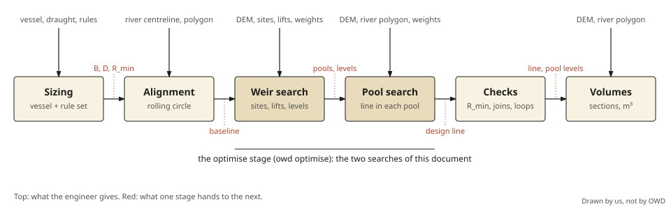

*Figure 1. The chain of stages and what passes between them. Drawn by us.*

| Stage | Reads | Gives |
|---|---|---|
| **Sizing** | vessel, draught, rule set | $B$, $D$, $R_{\min}$ |
| **Alignment** | river centreline, river polygon, $R_{\min}$ | the **baseline**: a line along the river with its bends opened to $R_{\min}$ |
| **Weir search** | baseline, DEM, river polygon, sites, lifts, weights | weirs, lifts, pool levels |
| **Pool search** | baseline, pools, DEM, river polygon, weights | the **design line** |
| **Checks** | design line | pass or fail, with the measured values |
| **Volumes** | design line, pool levels, DEM, river polygon | section areas and volumes |

The weir search and the pool search are one command, `owd optimise`. Each stage stores what it read
as a hash. When an input or an earlier result changes, the later stages show as stale and must run
again ([section 6](#6-guarantees-and-checks)).

**The baseline.** The alignment stage makes it with the *rolling circle*: a circle of radius
$R_{\min}$ rolls along the inside of each bend of the river centreline, and where the circle touches
the line twice the bend is replaced by the arc and a tangent straight. With a river polygon the
stage also checks, bend by bend, that the channel widened for the bend stays in the water, and tries
a wider arc where it does not. This document does not set out the rolling circle in
full. It matters here for one reason: both searches start from its line.

### The worked example

The example is a synthetic river 7,500<!--=river.length_m--> m long, written from formulas for this
document. No bundled example showed a cascade of weirs, a meander and a cut through a rise together,
so we added this one. It has:

- gentle bends of about 300 m radius, and one tight loop with bends of about 125 m, whose two limbs
  come within 279<!--=river.neck_width_m--> m of each other at the neck;
- a river 60 m wide with a bed 2.5 m below its water;
- a natural water level that rises 1 m per km;
- a plain 2.5 m above the water, a rise 6 m high between the two limbs of the loop at its neck, and
  a low bank near 5,800 m of river;
- a DEM with 10 m cells.

The vessel is a CEMT class IV motor vessel (85<!--=size.loa_m--> m by 9.5<!--=size.beam_m--> m) at a
draught of 2.5<!--=size.draught_m--> m, under the rule set PIANC WG 141 at its quality B (the
middle of that guideline's three levels of ease of navigation). The tool prints, untouched:

<!-- file: example/runs/setup.txt -->
```text
pianc-wg141@0.3.0 (se_quality B) x CEMT-IV: bottom width 30.4 m, R_min 255 m, design depth 3.25 m
Every Rule is unverified until a second reader checks it against its source.
$ owd align example.owd --method rolling-circle
Rolling circle: minimum radius 254 m on a 85 m chord against R_min 255 m: ok
fits in water (width only, no depth data): FAILS at 3 stretch(es)
NO FEASIBLE LINE: every bend is infeasible; the line is not a design
the design line is saved, marked failed: no_feasible_line, fits_in_water
owd: the design line fails: no_feasible_line, fits_in_water
```

So $B$ = 30.4<!--=size.bottom_width_straight_m--> m, $D$ = 3.25<!--=size.design_depth_m--> m and
$R_{\min}$ = 255<!--=size.min_bend_radius_m--> m. The baseline is
6,682<!--=align.length_m--> m long: the rolling circle has cut across the neck of the loop.

The alignment stage fails its own check here, and says so. The river is 60 m wide and its tight
bends have a radius of 125 m, so no line of radius 255 m can stay in the water there. The baseline is
still a line that holds $R_{\min}$, and the two searches can start from it. The engineer must read
that warning as it stands: at the loop the design leaves the river and cuts ground.

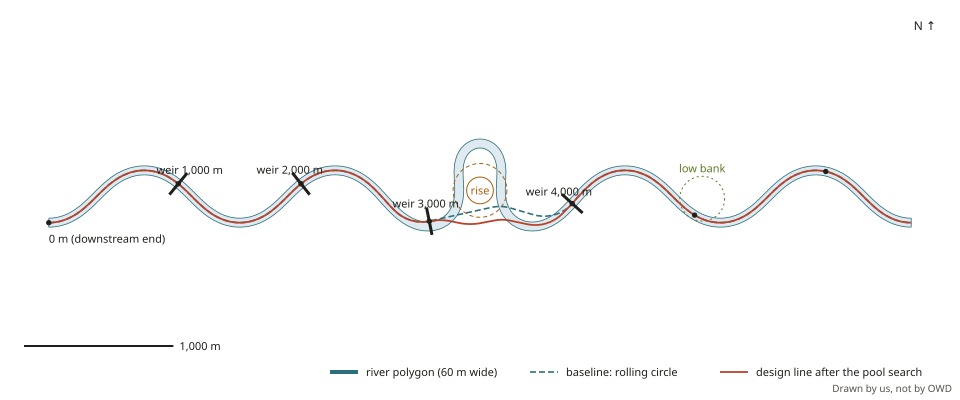

*Figure 2. The example in plan, with the result of the base run. The two rings round the rise are
90 m and 180 m from its top, where it is 3.6 m and 0.8 m high. Drawn by us from the run files.*

The base run offers six weir sites, one every 1,000 m of baseline, and lifts of 0.5, 1, 1.5 and 2 m.
The top pool must be at 6.5 m or above. That is a choice made for the example, and it is 1 m below
the natural water level at the upstream end of the river (7.5 m): nothing in OWD ties a pool level
to the natural water ([section 7](#7-what-the-cost-does-not-know-and-results-to-doubt)).

The example does not reach every part of the method. It has no pool longer than 6,000 m, so it has
no seams. Its lines do not loop, every pool's search closes on its end, and its DEM covers the
whole corridor. Those parts are described from the code and are pinned by the tests behind
[section 6](#6-guarantees-and-checks), not shown by a run here. The low bank plays little part in
the runs shown: the pool over it floods 0.5<!--=base.flood.pool5.flooded_ha--> ha.
[Appendix A](appendices.md#a-commands-for-every-number) gives every command.

## 3 The cut at one station

The volumes stage walks the design line. At each **station** it takes a section across the line and
measures the cut. This is the measure of record: quote volumes from this stage, not from a search.

### The section

At a station the stage knows the pool level $L$, the depth $D$ and the bottom half-width $b$. On a
straight $b = B/2$. In a bend the rule set widens the channel. Under the example's rule set the
widening is $\ell_v^2 / (2R)$ for a vessel of length $\ell_v$ on a radius $R$, half on each side:

$$b = \frac{B}{2} + \frac{\ell_v^2}{4 \max(R,\ R_{\min})} \quad \text{where } R < 2000 \text{ m}, \qquad b = \frac{B}{2} \quad \text{elsewhere}$$

$R$ is read on the stations themselves: at each station, the radius of the circle through it and the
stations two before and two after it; then the mean of that radius over the station and its two
neighbours on each side.

The **bed level** is

$$z_b = L - D$$

Offsets across the section are signed: negative towards the river's left bank (left as you look
downstream), positive towards its right bank. The cut face is the same on both sides, so in the
formulas $o$ stands for the size of the offset, the distance from the design line. The **cut
face** $z_f(o)$ is the level the ground is cut down to. The **channel prism** is the channel below
the pool level: the bed and the two under-water slopes. Under Cut Model A it has up to four parts:

| Part | Where | Level of the cut face $z_f(o)$ |
|---|---|---|
| Bed | $o \le b$ | $z_b$ |
| Under-water slope, 1 vertical to $m = 3$ horizontal | $b < o \le b + mD$ | $z_b + (o - b)/m$ |
| Berm, 2 m wide at the pool level | $b + mD < o \le b + mD + 2$ | $L$ |
| Upper slope, 1 vertical to 1.5 horizontal | $o > b + mD + 2$ | $L + (o - b - mD - 2)/1.5$ |

The under-water slope reaches the pool level at $o = b + mD$. The berm and the upper slope are cut on
a side only when that side is **benched**. A side is benched when ground stands above the pool level
inside the channel prism: take the sample nearest the line, on that side, with $o \le b + mD$ and
ground above $L$. If it lies more than 2 m inside the edge of the prism, that is if
$(b + mD) - o > 2$ m, the side is benched. On a side that is not benched nothing is cut beyond
$o = b + mD$: ground that stands above the pool level there is left as it is. The upper slope runs
until it meets the ground: that point is where the cut **daylights**. The **tallest face** the stage
reports is the greatest height of the ground above the pool level at a sample that is cut.

### The area and the volume

The section is sampled every $\Delta x$ = 1 m from 200 m left of the line to 200 m right of it.
At each sample the depth of cut is

$$c(o) = \max\bigl(z_g(o) - z_f(o),\ 0\bigr)$$

where $z_g$ is the ground level, read from the DEM by linear interpolation between the centres of
its four nearest cells. A sample inside the river polygon counts as
**dredge**; a sample outside it counts as **dry cut**. The areas of the station are

$$A_{\text{wet}} = \Delta x \sum_{o \in \Omega} c(o), \qquad A_{\text{dry}} = \Delta x \sum_{o \notin \Omega} c(o)$$

The volumes are the areas times the station spacing $\Delta s$ = 25 m, summed along the line:

$$V_{\text{wet}} = \Delta s \sum_{\text{stations}} A_{\text{wet}}, \qquad V_{\text{dry}} = \Delta s \sum_{\text{stations}} A_{\text{dry}}$$

There is no averaging between stations (no end-area rule): each station stands for 25 m of line.

One detail to know. The stations are spread evenly from one end of the line to the other, so their
true spacing is the line length over the number of gaps. In the example that is
25.08<!--=base.volumes.station_spacing_m--> m, and
268<!--=base.volumes.stations--> stations times 25 m count
6,700<!--=base.volumes.length_counted_m--> m of a line that is
6,696<!--=base.line.length_m--> m long: 0.06<!--=base.volumes.length_over_pct--> % more.

### One station by hand

Take the station at 3,511.1<!--=station.chainage_m--> m, in the pool at
$L$ = 6.00<!--=station.water_level_m--> m. It lies where the line leaves the river to cross the neck
of the loop.

- $R$ = 478<!--=station.by_hand.radius_m--> m, so
  $b = 15.2 + 85^2 / (4 \times 478.3)$ = 18.98<!--=station.half_width_m--> m;
- $z_b = 6.00 - 3.25$ = 2.75<!--=station.invert_m--> m;
- the under-water slope ends at $b + mD = 18.98 + 3 \times 3.25$ =
  28.73<!--=station.by_hand.slope_reach_m--> m from the line.

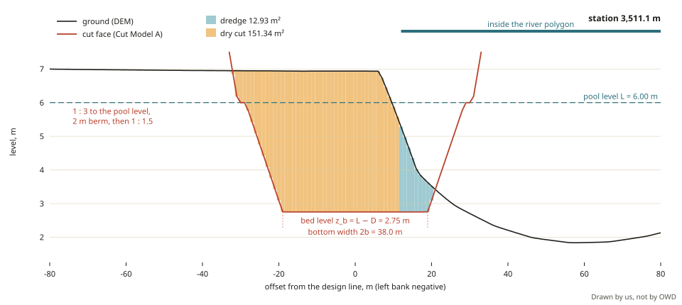

*Figure 3. The section at the station. The plain stands at about 6.94 m, above the pool level, and
reaches inside the channel prism on both sides of the line, so both sides are benched. On the right
the red face rises above the ground: nothing is cut there. The section reaches 200 m each side; the
middle 160 m is shown. Drawn by us from the stored section.*

Some of the 401<!--=station.by_hand.samples--> samples, from the file of the whole section
([appendix A](appendices.md#the-station-by-hand) says where it is and where the tool keeps the same
section):

| Offset $o$, m | Ground $z_g$, m | In the river | Part of the face | Face $z_f$, m | Cut $c$, m |
|---:|---:|:---:|---|---:|---:|
| −33 | 6.948 | no | upper slope: $6 + (33 - 28.73 - 2)/1.5$ | 7.516 | 0 |
| −32 | 6.948 | no | upper slope | 6.849 | 0.099 |
| −30 | 6.947 | no | berm | 6.000 | 0.947 |
| −24 | 6.944 | no | slope: $2.75 + (24 - 18.98)/3$ | 4.424 | 2.519 |
| −10 | 6.936 | no | bed | 2.750 | 4.186 |
| 0 | 6.936 | no | bed | 2.750 | 4.186 |
| 10 | 5.878 | no | bed | 2.750 | 3.128 |
| 12 | 5.281 | yes | bed | 2.750 | 2.531 |
| 18 | 3.735 | yes | bed | 2.750 | 0.985 |
| 20 | 3.519 | yes | slope: $2.75 + (20 - 18.98)/3$ | 3.091 | 0.428 |
| 21 | 3.415 | yes | slope | 3.424 | 0 |

53<!--=station.by_hand.cut_samples--> samples have a cut. Summing the cut of every sample, times
1 m:

| | By hand, from the samples | The tool |
|---|---:|---:|
| Dredge area $A_{\text{wet}}$, m² | 12.93<!--=station.by_hand.dredge_area_m2--> | 12.93<!--=station.dredge_area_m2--> |
| Dry cut area $A_{\text{dry}}$, m² | 151.34<!--=station.by_hand.dry_area_m2--> | 151.34<!--=station.excav_area_m2--> |

The two agree to better than one part in a million. The same formulas give the tool's areas at each
of the 21<!--=station.by_hand.stations_checked--> stations whose section the tool keeps. The station adds
$(12.93 + 151.34) \times 25$ = 4,107<!--=station.slice_m3--> m³ to the totals.

For the whole line the tool prints:

<!-- file: example/runs/base.txt -->
```text
$ owd volumes base.owd
Pool lattice: dredge 262511 m3, dry cut 120752 m3, tallest face 3.5 m
```

## 4 The weir search

### What is chosen

The weir search works on the baseline. In this section $s$ is chainage along the baseline, from the
downstream end, 0, to the upstream end, $s_{\text{end}}$.

- **Candidate sites.** The chainages where a weir may stand: a list from the engineer (`--sites`),
  or one every `site_step_m` (500 m by default), starting one step from the downstream end. A site
  at chainage 0 or beyond the end is dropped.
- **The lift menu.** The lifts a weir may have (`--lifts`; 0.5 and 1 m by default).
- **The base level** $L_0$: the water level below the first weir. By default it is the design's
  water level at the start of the line.
- **The top level** $L_{\text{top}}$ (`terminal_min_level_m`): the highest pool must be at or above
  it.
- **The level cap**: no pool may be above $L_{\text{top}}$ plus the largest lift.

A pool level can only be $L_0$ plus a sum of lifts. The search lists every such level up to the cap,
rounded to the millimetre. In the example these are the
18<!--=cascade.levels--> levels from 0 to 8.5 m in steps of 0.5 m.

### The cost

A cascade is a set of weirs $(s_1, l_1), \dots, (s_n, l_n)$. Write $s_0 = 0$ and
$s_{n+1} = s_{\text{end}}$. Pool $i$ runs from $s_i$ to $s_{i+1}$ at level $L_i$. The cost of the
cascade is

$$C = \sum_{i=0}^{n} R(s_i, s_{i+1}, L_i) + \sum_{i=1}^{n} \left( F + P\, l_i^{\,p} \right)$$

**The reach cost** $R(u, v, L)$ is the cost of a pool from chainage $u$ to chainage $v$ at level $L$:

$$R(u, v, L) = w_{\text{wet}} V_{\text{wet}}(u, v, L) + w_{\text{dry}} V_{\text{dry}}(u, v, L) + c_{\text{flood}} A_{\text{flood}}(u, v, L)$$

and $R = \infty$ when the pool breaks the bank limit (below).

$V_{\text{wet}}$ and $V_{\text{dry}}$ are the volumes of [section 3](#3-the-cut-at-one-station) on
the baseline, for the stations with $u \le s < v$, with the pool level $L$ and so the bed at $L - D$.
Before the search starts, the sections are measured once for every level in the list. A table of
running totals then gives any $V(u, v, L)$ as one subtraction. In this table the half-width is
$B/2$ at every station: the weir search does not widen the channel in bends. The station at the very
end of the baseline is in no pool ($s < v$ leaves it out), so the table counts one station fewer
than the baseline has.

**The structure cost** of a weir with lift $l$ is $F + P\, l^{\,p}$ (`structure_fixed`,
`structure_per_lift`, `structure_power`; 100,000, 200,000 and 1 by default). These defaults are in
the units of the cut cost. They are not prices: with weights of 1 they say a weir costs as much as
100,000 m³ of cut plus 200,000 m³ for each metre of lift. Set them to your own.

**The flood cost** (`flood_cost_per_ha`, 0 by default). $A_{\text{flood}}$ is the land a pool
floods. The ground within `flood_distance_m` (1,500 m) of the baseline is put on a grid of
`flood_cell_m` (25 m) cells; a cell's ground is the DEM at its centre. A cell counts as flooded by a
pool at level $L$ from $u$ to $v$ when all of these hold:

1. its centre is outside the river polygon;
2. its ground is below $L$;
3. it is joined to the river through cells that are below $L$ or in the river, each sharing a side
   with the next. A hollow with a rim at or above $L$ all round it stays dry;
4. the point of the baseline nearest to it has a chainage in $[u, v)$.

No bund is assumed beside a weir: low ground near a weir that joins the river on the far side of it
counts. Ground past the edge of the grid or of the DEM is not counted, so the area is a lower bound
when the water reaches that edge; the tool then warns.

**The building cost** (`building_cost`, 0 by default; BLD-1). With a buildings file loaded, each
pool also pays `building_cost` for each building it floods: a building counts when its point is in a
cell the pool floods by the rule above and the water there is at least `building_min_depth_m`
(0.3 m) deep, so a puddle does not count. Buildings below the file's confidence or area thresholds
are counted apart and never costed. Each building's lowest flooding level is one number, so the count
over a reach at a level is a prefix sum like $A_{\text{flood}}$: two reads a pool. The price is the
engineer's, not a fact. See [Buildings, places and settlements](../buildings-and-places.md).

**The bank limit** (`max_above_bank_m`, off by default) is a hard limit. No pool may stand more than
this height above **bank-full** anywhere along it. Bank-full is an estimate from the DEM, made on the
same 25 m grid. A **bank cell** is a cell outside the river polygon with a cell inside it among its
eight neighbours. It is on the left or the right of the baseline by where it lies from the nearest
point of the baseline, and in the 500 m of baseline that holds that point. In each 500 m, the bank
level of a side is the 25th percentile of the ground of its bank cells (a side needs three). Bank-full
of the 500 m is the lower of the two sides. A stretch with no bank cells takes its level from its
neighbours. A pool that breaks the limit costs infinity, so the search never
takes it. When no cascade can reach the top level inside the limit, the stage stops and names the
reach that blocks it. It never returns a cascade outside the limit.

### The algorithm

The search is a **dynamic programme**: a shortest path on a graph with no cycles.

- **State** $(j, L)$: a weir stands at site $j$ and holds the pool above it at level $L$. The start
  is $(0, L_0)$: no weir yet, at the downstream end.
- **Move** $(i, L) \to (j, L + l)$ for a later site $j > i$ and a lift $l$ of the menu, when the two
  sites are at least `min_spacing_m` apart (the downstream end counts as a site for this). Its cost is $R(s_i, s_j, L) + F + P\, l^{\,p}$: the pool
  between the two weirs, and the new weir.
- **End.** From any state $(j, L)$ with $L \ge L_{\text{top}}$, add the last pool
  $R(s_j, s_{\text{end}}, L)$.

Let $f(j, L)$ be the least cost to reach state $(j, L)$. Then

$$f(j, L') = \min_{i < j,\ l}\ \Bigl[ f(i, L' - l) + R(s_i, s_j, L' - l) + F + P\, l^{\,p} \Bigr], \qquad f(0, L_0) = 0$$

The sites are taken in order of chainage, so every $f(i, \cdot)$ is final before a later site reads
it. The answer is the least $f(j, L) + R(s_j, s_{\text{end}}, L)$ over the states with
$L \ge L_{\text{top}}$.

**Why it is exact.** Every move goes to a later site, so the graph has no cycles. The cost of a
cascade is a sum of terms, and each term depends only on one move: the two sites, the level between
them and the lift. So the least cost to reach a state does not depend on how the search goes on from
it, and the recurrence gives the optimum over every cascade the sites and the menu allow. It is
exact for the cost above, on the candidate sites and lifts given. It says nothing about sites or
lifts that were not offered.

**The work.** With $N$ sites, $N_L$ levels and $N_l$ lifts the search makes at most
$\frac{1}{2} N (N+1)\, N_L\, N_l$ moves, each a table read. In the example that is at most
$21 \times 18 \times 4$ = 1,512<!--=cascade.moves_bound-->. The long part is the table: one pass of
the sections for each level.

### The example

The base run has no flood cost and no bank limit. It reports the flooded land all the same. The tool
prints:

<!-- file: example/runs/base.txt -->
```text
$ owd optimise base.owd --lifts 0.5,1,1.5,2 --sites 1000,2000,3000,4000,5000,6000 --flood-report
weirs: 1000 m -> pool 2.0 m, 2000 m -> pool 4.0 m, 3000 m -> pool 6.0 m, 4000 m -> pool 6.5 m
Pool lattice: 1 pool(s) re-routed, minimum radius 254 m on a 85 m chord against R_min 255 m: ok
flooded land outside the river polygon: 7.2 ha, flood cost 0 at 0 per ha (cut cost 309031)
bank-full is an estimate from the DEM: in each 500 m of line, the 25th percentile of the ground in the cells that touch the river polygon, on each side of the line, and the lower of the two sides
  pool (m along the line) | level m | lift m | flooded ha | above bank-full m, lower / upper end | over the DEM river level m, lower / upper end
  0 to 1000 | 0.00 | - | 0.0 | -2.58 / -3.11 | 1.58 / 1.01
  1000 to 2000 | 2.00 | 2.00 | 0.0 | -1.64 / -2.06 | 2.49 / 1.98
  2000 to 3000 | 4.00 | 2.00 | 0.2 | -0.61 / -1.07 | 3.48 / 3.06
  3000 to 4000 | 6.00 | 2.00 | 6.5 | 0.39 / -0.94 | 4.08 / 3.22
  4000 to 6682 | 6.50 | 0.50 | 0.5 | -0.94 / -3.35 | 3.29 / 0.89
```

| Weir | Chainage, m | Lift, m | Pool level above it, m | Structure cost $F + P\,l$ |
|---|---:|---:|---:|---:|
| 1 | 1,000<!--=base.weir1.chainage_m--> | 2.0<!--=base.weir1.lift_m--> | 2.0<!--=base.weir1.pool_level_m--> | 500,000<!--=base.weir1.structure_cost--> |
| 2 | 2,000<!--=base.weir2.chainage_m--> | 2.0<!--=base.weir2.lift_m--> | 4.0<!--=base.weir2.pool_level_m--> | 500,000<!--=base.weir2.structure_cost--> |
| 3 | 3,000<!--=base.weir3.chainage_m--> | 2.0<!--=base.weir3.lift_m--> | 6.0<!--=base.weir3.pool_level_m--> | 500,000<!--=base.weir3.structure_cost--> |
| 4 | 4,000<!--=base.weir4.chainage_m--> | 0.5<!--=base.weir4.lift_m--> | 6.5<!--=base.weir4.pool_level_m--> | 200,000<!--=base.weir4.structure_cost--> |

The check of the total: cut 309,031<!--=base.cascade.reach_cost--> plus structures
1,700,000<!--=base.cascade.structures--> gives 2,009,031<!--=base.cascade.total_cost-->.

Three notes on the printed table. The tool prints hectares to one decimal: the total is
7.25<!--=base.flood.flooded_ha--> ha. The heights above bank-full are printed at the two ends of each
pool only; the limit is tested on the greatest height anywhere along the pool, which the design file
holds (the top pool's is −0.14<!--=base.flood.pool5.max_above_bank_m--> m, between its ends). "Over the
DEM river level" is the pool level less the middle value of the DEM over the river cells, in the
500 m at each end of the pool: a rough depth of water over the DEM's river.

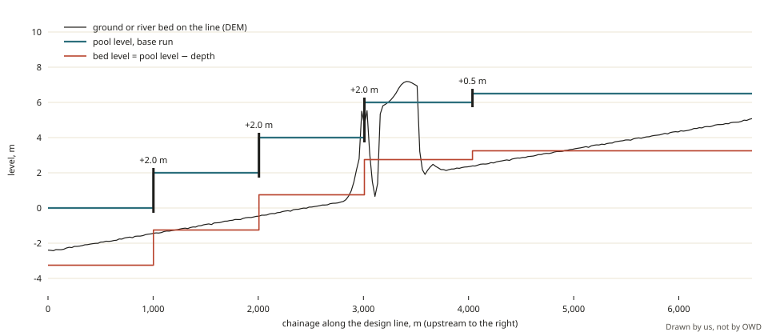

*Figure 4. The long section of the base run. The black line is the DEM on the design line: the river
bed in the river, the plain and the rise where the line crosses the neck. Chainage here is along the
design line, which is 14 m longer than the baseline, and a level steps at the first station of the
new pool: so the weir at 4,000 m of baseline shows near 4,040 m. Drawn by us from the stations of
the volumes stage.*

Read the result against the cost. The top pool must reach 6.5 m and the largest lift is 2 m, so at
least four weirs are needed. A higher pool always cuts less, and nothing in this run's cost counts
against a high pool. So the search takes the first four sites and the largest lifts as early as it
can. The pool from 3,000 m to 4,000 m then stands
0.39<!--=base.flood.pool4.max_above_bank_m--> m above bank-full and floods
6.5<!--=base.flood.pool4.flooded_ha--> ha. [Section 9](#9-test-it-yourself) shows what a flood cost
or a bank limit changes.

## 5 The pool search

### What is chosen

The weir search has fixed the pools. The pool search now looks, in each pool, for a line that costs
less than the baseline. It holds the pool's level, so the bed level $z_b = L - D$ is one number for
the whole pool.

A pool's line starts and ends on the baseline's point and heading at the two ends of the pool (it is
**pinned** there), so that the lines of two pools meet with no kink. Options below relax this.

The pool search does not steer round **no-go areas** (ground the engineer has marked as closed to
the channel). When the channel of its line enters one, the check `no_go_clear` fails and says so.

### The lattice

The line is built from a small set of moves ([figure 5](#fig-5)):

- **Arcs** of radius $R_{\min}$ times each of the `radius_multiples` (1, 1.5 and 3 by default), to
  the left and to the right. Each arc turns the heading by exactly one step. With `n_heading` = 16
  the step is $2\pi/16$ = 22.5°, so an arc of radius $R$ is $R \times 2\pi/16$ long.
- One **straight**, twice the `pitch_m` long (24 m by default).

<a id="fig-5"></a>

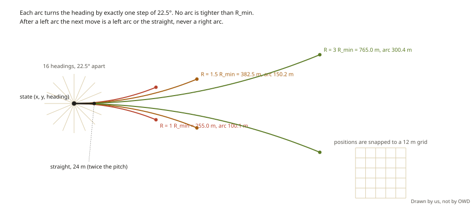

*Figure 5. The seven moves, to scale for the example. Drawn by us.*

| Move | Radius, m | Length, m |
|---|---:|---:|
| Arc at $R_{\min}$, left or right | 255.0<!--=lattice.radius_m.1--> | 100.1<!--=lattice.arc_m.1--> |
| Arc at 1.5 $R_{\min}$, left or right | 382.5<!--=lattice.radius_m.1.5--> | 150.2<!--=lattice.arc_m.1.5--> |
| Arc at 3 $R_{\min}$, left or right | 765.0<!--=lattice.radius_m.3--> | 300.4<!--=lattice.arc_m.3--> |
| Straight | none | 24.0 |

The stage refuses a radius multiple below 1. So no arc of the lattice is tighter than $R_{\min}$,
and every move starts on the heading the one before it ended on. The line holds $R_{\min}$ and has no
kink **by construction**.

**The state** of the search is where the line has got to:

- its position, snapped to a grid of `pitch_m` (12 m);
- its heading, as one of the 16 steps;
- the direction of its last arc. After a left arc the next move may be a left arc or the straight,
  never a right arc: at least one straight lies between two opposite curves. With `min_straight_m`
  set, the state also counts the straights since the last arc, and the opposite arc is not allowed
  until the straight is at least that long. It counts whole straights of 24 m, so the length held is
  the next multiple of 24 m at or above the setting.

Two lines that reach the same state are treated as the same from there on; the cheaper one is kept.

### The cost of a move

Each move is costed by sweeping a simple channel section along it. This is the **search cost**. It
is not the measure of section 3 ([section 7](#7-what-the-cost-does-not-know-and-results-to-doubt)
compares them).

Sections are taken across the move about every 10 m (every 12 m on the straight); let $\delta$ be
their true spacing. A section stands at the end of each step of $\delta$ along the move, square to
the move's heading there, and stands for that step. (On a move, the setting `ds_step_m` thins the
sections only when it is set above 10 m.) Each section is a **rake** of samples every `rake_step_m` ($\Delta o$ = 4 m) out to
`rake_half_m` (250 m) either side of the line. With these defaults the samples stand at 2, 6, 10,
14 m and so on either side: none is on the line itself, and the 8 samples within the half-width of
the example (15.2 m) stand for 32 m of a bottom that is 30.4 m wide. The ground $z_g$ is read from
the DEM on a grid of `cell_m` (2 m) cells. At a sample at distance $o$ from the line:

- **On the bottom** ($o \le b$): the cut is $c = \max(z_g - z_b,\ 0)$.
- **On a side slope** ($o > b$): the cut is $c = \max\bigl(z_g - z_b - (o - b)/m,\ 0\bigr)$, with the
  slope $m$ = `side_slope` (3). It is counted only when two things hold: the sample is outside the
  river polygon, and somewhere on the bottom of the same section a sample outside the river polygon
  has a cut. A section whose bottom is all in the river, or all below the bed level, has no side
  slopes in the search cost.

Here $b = B/2$ on every move, with no widening in bends.

The cost of the move is

$$c_{\text{move}} = \Delta o\, \delta \sum_{\text{samples}} w\, c \;+\; \lambda\, \ell \;+\; \mu\, a_{\text{land}}$$

- $w = w_{\text{wet}}$ for a sample inside the river polygon and $w_{\text{dry}}$ outside it.
- $\ell$ is the length of the move and $\lambda$ the **cost per metre of line** (`length_weight`,
  0 by default).
- $a_{\text{land}}$ is the land the move takes and $\mu$ the **land cost** (`land_weight`, 0 by
  default). The land taken is $\Delta o\, \delta$ times the number of samples with
  $o \le b + mD$ that are outside the river polygon. $b + mD$ is the half-width of the channel at
  the water surface, so this is the plan area of the channel outside the river, cut or no cut.

A sample with no known ground (off the DEM or off the search grid) has no cut. A move is refused when
fewer than 60 % of its bottom samples are on known ground.

The search grid is filled once for each pool: the DEM is read, as in section 3, at the centre of
every 2 m cell, and the search then interpolates between those centres. The baseline is costed with
the same section, as a chain of straights between its points, with a section at least every 8 m
(`ds_step_m`).

**Why the two extra weights exist.** Ground below the bed level costs nothing to cut. A pool can
drown a wide plain deeper than the bed. Then, with $\lambda = \mu = 0$, a line over the drowned plain
costs the same as a line in the river, and a longer line costs the same as a shorter one. The cost
per metre makes length count. The land cost makes leaving the river count. Both are in the units of
the cut cost: $\lambda$ = 10 means one metre of line costs as much as 10 m³ of cut, and $\mu$ equal
to the depth $D$ prices a m² of land like a cut of the full depth over that m².

### The search

The search is **A\***. From the start state it keeps a list of states reached, each with the least
cost found to reach it, $g$. It takes the state with the least $g + e$, tries the seven moves from
it, and stops when it takes the end.

**The estimate $e$** of the cost still to pay is the straight distance to the end times a cost per
metre, $c_{\min}$. $c_{\min}$ is the cheapest metre the search can find before it starts: it costs a
12 m straight at points 24 m apart in the corridor (4,000 points at most), in 8 headings, and takes
the least. When the cheapest ground is free, $c_{\min} = \lambda$, and with $\lambda = 0$ the
estimate is zero: the search then spreads evenly in all directions (Dijkstra's method).

**Is the result optimal?** For a graph with fixed states and an estimate that never exceeds the true
cost, A\* gives the optimum. Here neither condition holds exactly.

- The states are **snapped**. Two lines that end within the same 12 m cell and the same heading step
  are merged, though they end at slightly different points. The line is rebuilt at the end from the
  true start, move by move, and its cost is read again on the line as built.
- The estimate is **sampled**. $c_{\min}$ is the least of the points tried, not a proven least. A
  cheaper metre between the points would make the estimate too high.
- The lattice is **coarse**. The line can change heading only by 22.5° at a time and only on three
  radii. The baseline is not made of these moves.

So this document calls the result **the least cost found**, not the optimum. The example shows the
difference. In the base run, 4<!--=base.search.dearer--> of the
5<!--=base.search.pools--> searched lines cost *more* than the baseline they were meant to beat:

| Pool, m | Level, m | Searched line | Baseline | Used |
|---|---:|---:|---:|---|
| 0 to 1,000 | 0.0<!--=base.pool1.water_level_m--> | 49,893<!--=base.pool1.cost--> | 49,060<!--=base.pool1.baseline_cost--> | baseline |
| 1,000 to 2,000 | 2.0<!--=base.pool2.water_level_m--> | 25,743<!--=base.pool2.cost--> | 17,230<!--=base.pool2.baseline_cost--> | baseline |
| 2,000 to 3,000 | 4.0<!--=base.pool3.water_level_m--> | 13,223<!--=base.pool3.cost--> | 12,075<!--=base.pool3.baseline_cost--> | baseline |
| 3,000 to 4,000 | 6.0<!--=base.pool4.water_level_m--> | 66,460<!--=base.pool4.cost--> | 131,415<!--=base.pool4.baseline_cost--> | searched line |
| 4,000 to 6,682 | 6.5<!--=base.pool5.water_level_m--> | 68,315<!--=base.pool5.cost--> | 66,785<!--=base.pool5.baseline_cost--> | baseline |

*Search cost of each pool in the base run, in m³ at weight 1.*

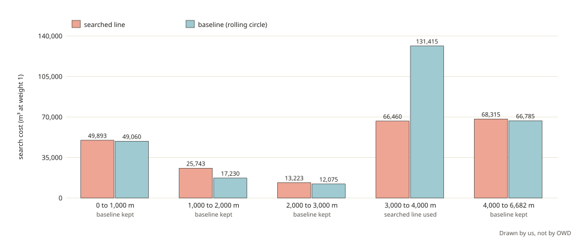

*Figure 6. The table as a chart. Drawn by us from the run files.*

Where the baseline follows the middle of the river, the lattice cannot follow it as closely, and its
pinned ends cost it more (below). Only in the pool with the loop, where the baseline crosses the
neck over the rise, did the search find a cheaper line.

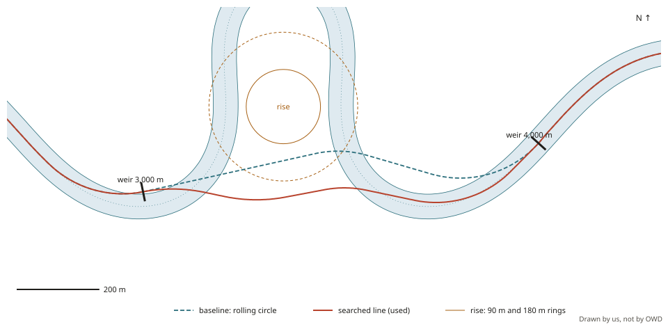

*Figure 7. The one pool the search re-routed. The baseline crosses the neck on the flank of the rise.
The searched line passes further from the rise and stays longer in the river. Drawn by us from the
run files.*

### The rule for keeping the baseline

After a pool is searched, its line replaces the baseline only if it passes this rule, in order:

1. The search found no line (it did not converge, or it hit its limit of 4,000,000 states): **keep
   the baseline**, and say why.
2. The line crosses itself: **keep the baseline**.
3. The line costs more than the baseline *and* the baseline holds $R_{\min}$ (or the line does not
   hold it either): **keep the baseline**.
4. Otherwise **use the line**. A baseline that breaks $R_{\min}$ is never kept in place of a line
   that holds it.

Both costs in step 3 are the search cost, read the same way on the baseline and on the line. The
volumes stage is not asked. Every pool's record says whether its line was used and, if not, why.

### The corridor

Each pool is searched on a grid that covers the **corridor**: every point within `corridor_half_m`
(350 m) of the pool's stretch of baseline. By default the corridor only says where $c_{\min}$ is
sampled; the line may go anywhere in the rectangle round the corridor. With `corridor_limit` on, no
state, no point of a move and no point of a closing path may lie outside the corridor (to the
nearest 2 m cell). A pool with no line inside the corridor keeps its baseline and says so.

### The end of a pool: the closing path

The moves of the lattice do not land exactly on the end of the pool. So from every state within
3 $R_{\min}$ of the end, the search tries a **closing path**: an arc of $R_{\min}$, a straight
tangent to it, and a second arc of $R_{\min}$ that ends on the end point with the end heading
([appendix C](appendices.md#c-derivations)). The total turn of the two arcs is at most 180°. The
path is costed like any move. The end is a state of its own, reached only through a closing path, so
the line ends on the baseline's point and heading exactly.

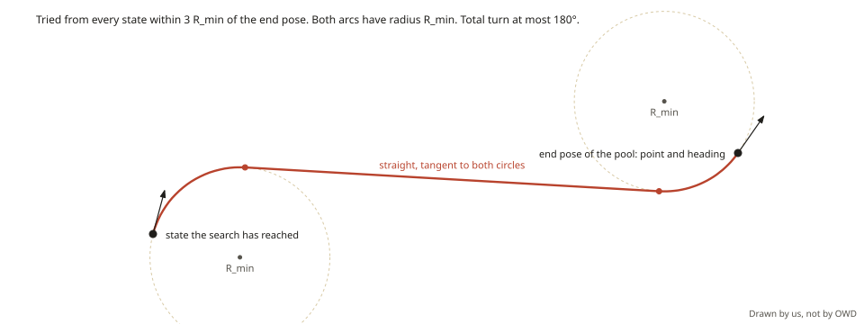

*Figure 8. A closing path. Drawn by us.*

When no closing path is found, the search falls back to a state within 6 m and one heading step of
the end, and the pool is marked as not closed. Such a pool is searched again with its end moved
along the baseline, in steps of a quarter of $R_{\min}$, up to four steps forward along the chainage and then four
back. The first end that closes is used, and a warning names the pool and the move. Only the end
of the search moves; the weir and the level stay. If no end closes, the line is used only when its
join holds $R_{\min}$ and does not cross itself; else the pool keeps its baseline.

**A pinned end has a cost.** The line must reach one exact point on one exact heading, through arcs
of $R_{\min}$. In the example, the pool from 2,000 m to 3,000 m has a search cost of
13,223<!--=base.pool3.cost--> with both ends pinned. With its upstream end free to pass anywhere on a
gate across the river (below), the same pool has a search cost of
1,022<!--=free-seams-0.pool3.cost-->. These are search costs. By the volumes stage the freed end
saves 6,019<!--=free-seams-0.volumes.total_saved_m3--> m³ of
383,263<!--=base.volumes.total_m3--> m³, or 1.6<!--=free-seams-0.volumes.total_saved_pct--> %
([section 9](#free-seams)).

### Long pools, seams and weir sites

- **Pieces.** A pool longer than 6,000 m is searched as equal pieces, each at most 6,000 m, at the
  same level. A boundary between two pieces is a **seam**. Each seam moves, by up to an eighth of
  the piece length, to where the baseline turns least.
- **Seams on straights** (`seams_on_straights`). The seam goes where the baseline is straightest and
  inside the river polygon, within `seam_window_m` (1,500 m) of the even split.
- **Free seams** (`free_seams`). The line is not pinned at a seam or at a weir site between two
  pools. It passes a **gate**: the stretch of the cross-line through the baseline's point that lies
  in the river (or `seam_offset_m` either side), with a heading within `seam_heading_tol_deg` (30°)
  of the baseline's. The next search starts from the point and heading the line ended on, so there
  is no gap. Of two ends that cost the same, the search prefers the one nearer the middle of the
  gate and the river's heading: an end at the edge must be 1 % cheaper to be taken.
- **The straight through a weir** (`weir_straight_m`; two vessel lengths by default, 170 m in the
  example). With free seams, the line at a weir site must be straight for this length, half upstream
  of the weir and half downstream: a lock stands there. Where the search finds no such line, the
  weir site is pinned as before and a warning gives the reason.
- The two ends of the whole line stay pinned.

### The loop guard

A state holds no memory of where the line has been, so the least-cost line can cross its own track,
above all where length is free. A design line must never contain a loop. So:

- a pool whose own line crosses itself is searched again on moved ends, and keeps its baseline when
  no end gives a simple line;
- after the pools are joined, a pool whose line crosses the rest of the line keeps its baseline, the
  later pool first, until the line is simple;
- a line that still crosses itself fails the check `no_self_crossing`, with the chainage of the first
  crossing.

### With no DEM

A design with no DEM has no ground to cut. The stage then chooses no weirs. It searches the whole
line for the least plan area of channel outside the river polygon, in m², with $\mu$ = 1 unless
`land_weight` is set, plus the cost per metre. The results say `optimised_on: "plan_area"`.

### The settings

[Appendix B](appendices.md#b-settings) lists every setting with its name as you type it, its unit,
its default and what it does. A test holds that table to the engine's own defaults.

## 6 Guarantees and checks

### What holds by construction

| What | Why it holds |
|---|---|
| No arc of a searched line is tighter than $R_{\min}$<!--test: tests/optimise/test_optimise_lattice.py::test_property_no_primitive_is_tighter_than_r_min--> | Every arc has radius $R_{\min}$ times a multiple, and a multiple below 1 is refused. Closing paths use $R_{\min}$. |
| The heading of a searched line is continuous<!--test: crates/owd-core/tests/lattice_closing_radius.rs::the_hill_case_holds_r_min_at_every_r_min--> | Each move starts on the heading the last one ended on; the line is rebuilt from the start, move by move. |
| Two pools meet on the same point and heading<!--test: crates/owd-core/tests/lattice_pool_joins.rs::two_pools_join_at_r_min--> | Both are pinned to the baseline there, or the second starts where the first ended (free seams). |
| A straight lies between a left curve and a right curve<!--test: crates/owd-core/tests/lattice_free_joins.rs::a_minimum_straight_separates_opposite_curves--> | The state holds the direction of the last arc. |
| With `corridor_limit`, the line stays in the corridor<!--test: crates/owd-core/tests/lattice_corridor_limit.rs::with_the_limit_no_part_of_the_line_leaves_the_corridor_on_an_open_plain--> | Every point of every move is tested, to the nearest 2 m cell. |
| The cascade is the optimum for its cost, sites and lifts<!--test: tests/optimise/test_optimise_cascade.py::test_golden_dp_equals_brute_force--> | Shortest path on a graph with no cycles (section 4). |
| No pool breaks the bank limit<!--test: crates/owd-core/tests/flood_land.rs::with_a_bank_limit_no_pool_stands_above_it--> | Such a pool costs infinity; with no cascade inside the limit the stage stops. |
| A pool level is never read from a neighbouring level<!--test: tests/optimise/test_optimise_cascade.py::test_level_table_reach_is_additive_and_refuses_unknown_levels--> | The table is built on exactly the levels the lifts can reach; any other level is refused. |
| A looped line is never used for a pool<!--test: crates/owd-core/tests/lattice_self_crossing.rs::a_pool_whose_own_line_crosses_itself_is_never_spliced--> | The rule for keeping the baseline, step 2. |

"By construction" is about the arcs and the joins as built. The baseline is not built this way, and
where a pool keeps its baseline the design line is the baseline there. So the whole line is also
checked.

### What is checked after

| Check | How it is read | Tolerance |
|---|---|---|
| $R_{\min}$ on a chord<!--test: crates/owd-format/tests/lattice_r_min.rs::every_returned_lattice_line_meets_r_min--> | The line is resampled; the radius of the circle through three points half a chord apart is taken along the whole line, forward and backward; the least is the measured radius. The chord is $R_{\min}/3$ (one vessel length under the usual rule) unless `check_chord_m` sets it. | Passes when the measured radius is at least 0.98 $R_{\min}$. The 2 % is for the reading on a polyline, not a relaxation of the design. |
| Joins<!--test: crates/owd-core/tests/lattice_pool_joins.rs::a_join_that_breaks_r_min_is_reported--> | At each join of a searched line, the same radius reading on the line one chord either side of the join; and the gap in position and heading between the two pieces. | The same 0.98 $R_{\min}$. A closed pool has a gap of zero. |
| `no_self_crossing`<!--test: crates/owd-format/tests/lattice_self_crossing.rs::a_self_crossing_lattice_line_never_passes--> | Every pair of segments of the design line is tested for a crossing. | None: exact on the polyline. |
| The straight at a weir site<!--test: crates/owd-core/tests/lattice_free_joins.rs::the_line_is_straight_through_a_weir_site_on_a_straight--> | With free seams: the length round the weir site over which the heading stays within 0.0001 rad. | At least `weir_straight_m`, less 1 µm. |
| A search that hit its limit<!--test: crates/owd-core/tests/lattice_long_pool.rs::a_pool_that_hits_the_cap_says_so--> | The pool's record and a warning. | None. |
| Stale stages<!--test: crates/owd-format/tests/stale_lattice.rs::a_fresh_lattice_line_is_the_design_line_and_a_stale_one_is_not--> | Each stage stores a hash of its inputs, its settings, and the settings and results of every stage before it. `owd status` compares. | Any change of a value. |

In the base run the design line reads 254.2<!--=base.line.measured_min_radius_m--> m on an
85<!--=base.line.radius_check_chord_m--> m chord against 255 m. That passes inside the 2 %. The low
reading is on the baseline (the rolling circle reads the same
254.2<!--=align.measured_min_radius_m--> m), not on a searched arc. The two joins of the searched
pool read 255.0<!--=base.join1.measured_min_radius_m--> m and
629.7<!--=base.join2.measured_min_radius_m--> m.

A failed check does not stop the tool. The design is saved and marked, and the command line warns;
with `--strict` the command exits with an error.

## 7 What the cost does not know, and results to doubt

Each item says what the cost misses, where you can see it in the example, and what you can do.

**First, what is outside the method altogether.** OWD's optimisation has no hydraulics. It has no
discharge, no backwater, no velocity, no flood flow and no weir capacity. A pool is still water at
one level from weir to weir. "Flooded land" is ground below that still level. Nothing ties a pool
level to the natural water: in the example the top pool, at 6.5 m, is 1 m below the natural water at
the upstream end, and the search does not know it. Sediment, locks, lockage water, foundations and
price are outside it too. Check all of these by other means.

**1. Ground the pool drowns below the bed level costs nothing.**<!--test: crates/owd-core/tests/lattice_land_cost.rs::land_is_charged_where_nothing_is_cut_and_never_inside_the_river-->
The cut is $\max(z_g - z_b, 0)$, so ground below the bed is free, river or plain. A line over a
drowned plain costs the same as a line in the river. *What to do:* set the land cost
(`--land-weight`, a first value is the depth $D$), and look at the line on the plan.

**2. Ground the search cannot see costs nothing.**<!--test: crates/owd-core/tests/optimisation_doc_claims.rs::unknown_ground_costs_no_cut_and_a_move_needs_six_tenths_of_its_bottom_known-->
A sample off the DEM, or off the search grid, has no cut. A move is refused only when under 60 % of
its bottom samples are known, so up to 40 % of the bottom, and all of the side slopes, can be
unknown and free. With the land cost on, unknown ground counts as land and is charged. *What to do:*
use a DEM that covers the corridor (350 m either side of the baseline, plus the reach of the side
slopes), and compare with the volumes stage, which leaves unknown ground out in the same way.

**3. The search cost is a simpler section than the volumes stage measures.**<!--test: crates/owd-core/tests/optimisation_doc_claims.rs::the_search_section_is_not_cut_model_a-->
The two differ in five ways:

| | Search cost (section 5) | Volumes stage (section 3) |
|---|---|---|
| Side slopes | One slope of 1 : 3 from the bed up to the ground | 1 : 3 to the pool level; above it, only on a benched side, a 2 m berm and 1 : 1.5 |
| Where slopes count | Only outside the river polygon, and only in a section whose bottom cuts dry ground | Everywhere the ground is above the face |
| Bottom width in bends | $B/2$ everywhere | Widened by the rule set |
| Sampling | 4 m across (the bottom is 32 m of samples for 30.4 m), about 10 m along | 1 m across, 25 m along |
| Reach across the line | 250 m | 200 m |

So a search cost is not a volume. *What to do:* quote volumes from the volumes stage only.

**4. The chain holds three different measures of the cut.**<!--test: crates/owd-cli/tests/optimisation_doc.rs::the_base_run_gives_the_documents_numbers-->
In the base run:

| Measure | On which line | Cut, m³ |
|---|---|---:|
| The weir search's reach cost | the baseline, no bend widening | 309,031<!--=base.cascade.reach_cost--> |
| The pool search's cost of the final line | the design line, search section | 211,610<!--=base.search.final_cost--> |
| The volumes stage | the design line, widened in bends | 383,263<!--=base.volumes.total_m3--> |

*What to do:* compare options on the volumes stage. Treat the other two as what steered the
searches.

**5. The weir search measures the cut on the baseline, before the pool search moves the line.**<!--test: crates/owd-format/tests/optimise.rs::weirs_pools_and_the_lattice_option_equal_the_core_called_directly-->
It is not run again on the moved line. It also reads no bend widening. *What to do:* where the pool
search moved the line far, treat the pool levels there as provisional, and compare the weir
search's cut with the volumes stage's.

**6. The weir search does not see the land cost or the cost per metre.**<!--test: crates/owd-format/tests/optimise.rs::a_positive_land_weight_is_hashed_and_shown_and_never_reaches_the_volumes-->
Both are read by the pool search only. Every cascade covers the same baseline, so a cost per metre
would add the same to each; the land taken by the channel is not worked out per level. *What to do:*
none needed for the length. For land, use the flood cost and the bank limit, which the weir search
does read.

**7. The baseline is kept or replaced on the search cost, not on a full measure.**<!--test: crates/owd-core/tests/lattice_baseline_r_min.rs::a_cheaper_baseline_that_holds_r_min_is_kept_and_says_why-->
A line that is cheaper by the search cost can be dearer by the volumes stage, and the reverse.
*What to do:* read each pool's record: its cost and its baseline's cost. Where the two are close,
do not read the choice as significant.

**8. The search is not proven optimal, and can return a line dearer than the baseline.**<!--test: crates/owd-cli/tests/optimisation_doc.rs::the_base_run_gives_the_documents_numbers-->
Section 5 gives the reasons and the example: four pools of five. The rule for keeping the baseline
catches these. *What to do:* read each pool's record. A pool that kept its baseline was searched and
lost; that is a result, not a fault. A finer lattice (`pitch_m`, `n_heading`, more
`radius_multiples`) follows the river more closely and runs longer.

**9. The lattice is coarse.**<!--test: crates/owd-core/tests/optimisation_doc_claims.rs::the_default_lattice_has_sixteen_headings_three_radii_and_a_straight_of_twice_the_pitch-->
Sixteen headings, three radii, a straight of twice the pitch. A bend of 10° can be made only by a
closing path. A line at a small angle to the grid is a staircase of 22.5° arcs. *What to do:* look
for needless small S-bends on the plan; try `n_heading` = 24 or 32.

**10. A pinned end is costly.**<!--test: crates/owd-cli/tests/optimisation_doc.rs::free_seams_with_no_weir_straight_gives_the_documents_numbers-->
The example: a search cost of 13,223 pinned against 1,022 with a free end, for the same pool (1.6 %
of the volume of the whole line, by the volumes stage). A pinned point on a
bend forces a curve of $R_{\min}$ beside it; a pinned point off the river forces the line off the
river there. *What to do:* choose weir sites on straights; try `--free-seams`.

**11. Bank-full is an estimate.**<!--test: crates/owd-core/tests/flood_land.rs::bank_full_is_the_stated_percentile_of_the_ground_beside_the_polygon-->
It is a percentile of DEM cells beside the river polygon. A coarse DEM, or a polygon drawn wide of
the water, moves it. On a DEM that reads the water surface in the river and not the bed, the levels
beside the polygon are what they are. *What to do:* check the printed heights above bank-full
against banks you know; set the limit with that in mind.

**12. Flooded land is a count of grid cells.**<!--test: crates/owd-core/tests/flood_land.rs::reach_ends_add_up_and_a_flood_at_the_grid_edge_is_flagged-->
The cells are 25 m, no bund is assumed at a weir, and land past 1,500 m or past the DEM is not
counted. *What to do:* heed the warning that a pool reaches the edge of the grid; widen
`flood_distance_m`; treat the hectares as a first figure.

**13. A price per hectare is the engineer's judgement.**<!--test: crates/owd-format/tests/optimise.rs::the_flood_settings_are_off_by_default_round_trip_and_are_validated-->
The flood cost is off by default. It stands for land, crops, houses and roads. No value of it is a
fact, and the same holds for the structure costs $F$ and $P$ and for $\lambda$ and $\mu$. *What to
do:* run two or three values and see whether the weirs move (section 9).

**14. The weirs stand only where you offer sites, with the lifts you offer.**<!--test: tests/optimise/test_optimise_cascade.py::test_property_result_obeys_spacing_terminal_and_cap-->
The search is exact on that menu and blind outside it. A weir takes a structure cost that depends on
its lift alone: not on the width of the river, the ground or the access. *What to do:* offer the
sites an engineer would consider, and a menu fine enough to show the trade.

## 8 The planned method

> **NOT IN ANY RELEASE. NOT BUILT.** This section records a design that is intended. Nothing in it
> is in OWD's code, in a release or in the development branch. It has been tried only as a prototype
> outside this repository. It is written down here so that, when it is built, the build can be
> checked against it.

**Why it is planned.** Take a river that is narrower than the channel and has bends tighter than
$R_{\min}$. The channel cannot stay in the water whatever the line. A free search over a corridor
then sees cheap ground on both sides of the river and has no reason of its own to prefer the river:
the cost of section 5 prices cut, and low ground beside the river can cut as cheaply as the river
bed. The land cost helps but is a weight to tune, not a rule. The planned method turns the order
round. It builds the line from the river first, so the line is in the river wherever $R_{\min}$
allows, and only then lets the cost move it.

It has three steps.

### (a) A seed line

A line of circular arcs and straights along the river centreline, with these properties:

- tangent at every join (no kink);
- no arc tighter than $R_{\min}$;
- as close to the river centreline as $R_{\min}$ allows.

The seed has a curvature $k_0(s)$ that is constant on each piece: zero on a straight, $\pm 1/R$ on
an arc.

### (b) Meander cut-throughs as an explicit choice

Where the river loops, the line can follow the loop or cut across its neck. The planned method makes
this a choice the engineer can see. Each cut-through is costed both ways, and is accepted only when
all three of these hold:

1. it saves at least a stated length of line;
2. its total cost is no more than the cost of staying in the loop;
3. its tallest cut face is under a stated limit, or is no taller than the tallest face of staying.

Each accepted or refused cut-through is reported with its numbers.

### (c) A sideways shift

The design line is the seed plus a sideways offset. Let $\mathbf{r}_0(s)$ be the seed,
$\mathbf{N}(s)$ its unit normal to the left, and $d(s)$ the offset at seed chainage $s$. The line is

$$\mathbf{r}(s) = \mathbf{r}_0(s) + d(s)\, \mathbf{N}(s)$$

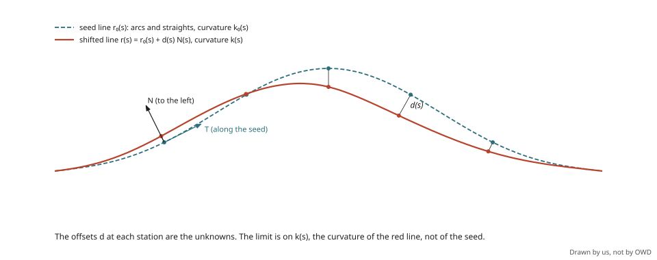

*Figure 9. The seed line and the shifted line. The seed is drawn as a smooth curve here; the planned
seed is arcs and straights. Drawn by us.*

The unknowns are the offsets at the stations of the seed. They are found by dynamic programming
along the seed: the state at a station is the offset there (and the offset one station back, so that
$d'$ and $d''$ can be formed), and the cost of a step is the cut cost of the channel on the shifted
line between two stations: the same cut cost as the rest of the chain uses. With no ground model the
cost is the plan area of the channel outside the river polygon.

The hard limit is on the curvature of the shifted line, not of the seed:

$$\lvert k(s) \rvert \le \frac{1}{R_{\min}}, \qquad k = \frac{(1 - k_0 d)\bigl(k_0 (1 - k_0 d) + d''\bigr) + d'\,\bigl(k_0'\, d + 2 k_0\, d'\bigr)}{\bigl((1 - k_0 d)^2 + d'^2\bigr)^{3/2}}$$

Primes are derivatives along the seed. [Appendix C](appendices.md#c-derivations) derives this
formula and checks it with numbers. Three things follow from it:

- With $d = 0$ it gives $k = k_0$: no shift, the seed.
- With a constant offset on an arc of radius $R_0$ it gives $k = 1/(R_0 - d)$: a shift towards the
  centre of the bend tightens it. A seed arc at $R_{\min}$ cannot be shifted inward at all.
- The term $d''$ means that a shift that changes quickly along the line adds curvature of its own,
  on a straight too.

Because the line is an offset of a line that follows the river, and the offsets are bounded, the
line stays in the river's corridor by construction.

**An open point: the joins of the seed.** The seed is arcs and straights, so its curvature $k_0$
jumps at every join and $k_0'$ does not exist there. The first derivative above is
$\mathbf{r}' = (1 - k_0 d)\,\mathbf{T} + d'\,\mathbf{N}$, so the heading of the shifted line differs
from the seed's by the angle $\arctan\bigl(d' / (1 - k_0 d)\bigr)$. Where $k_0$ jumps, that angle
jumps too, unless $d = 0$ or $d' = 0$ at the join. A straight that meets an arc of 300 m, shifted by
$d$ = 20 m with $d'$ = 0.1, has a kink of 0.4° at the join. So the formula alone does not make the
shifted line smooth. The method must do one of these at each join: hold $d' = 0$ there, or build the
seed with a transition between its pieces. This document does not yet say which. It must say so,
with a test, when the method is built.

## 9 Test it yourself

Change one input at a time on the example and see what moves. Each run below starts from the same
design, after sizing and alignment, and adds one flag to the base command of section 4. Volumes are
from the volumes stage. [Appendix A](appendices.md#a-commands-for-every-number) has the commands in
full.

| Run | Added to the base command | Weirs' pool levels, m | Pools re-routed | Dredge, m³ | Dry cut, m³ | Flooded, ha |
|---|---|---|---:|---:|---:|---:|
| Base | none | 2 / 4 / 6 / 6.5 | 1<!--=base.line.n_replaced--> | 262,511<!--=base.volumes.dredge_m3--> | 120,752<!--=base.volumes.excav_m3--> | 7.25<!--=base.flood.flooded_ha--> |
| Cost per metre 300 | `--length-weight 300` | same | 3<!--=length-300.line.n_replaced--> | 263,216<!--=length-300.volumes.dredge_m3--> | 144,060<!--=length-300.volumes.excav_m3--> | 7.25<!--=length-300.flood.flooded_ha--> |
| Cost per metre 1,000 | `--length-weight 1000` | same | 5<!--=length-1000.line.n_replaced--> | 204,319<!--=length-1000.volumes.dredge_m3--> | 529,851<!--=length-1000.volumes.excav_m3--> | 7.25<!--=length-1000.flood.flooded_ha--> |
| Land cost 3.25 | `--land-weight 3.25` | same | 1<!--=land.line.n_replaced--> | 262,062<!--=land.volumes.dredge_m3--> | 121,763<!--=land.volumes.excav_m3--> | 7.25<!--=land.flood.flooded_ha--> |
| Flood cost 3,000 | `--flood-cost-per-ha 3000` | same | 1<!--=flood-3000.line.n_replaced--> | 262,511<!--=flood-3000.volumes.dredge_m3--> | 120,752<!--=flood-3000.volumes.excav_m3--> | 7.25<!--=flood-3000.flood.flooded_ha--> |
| Flood cost 20,000 | `--flood-cost-per-ha 20000` | 2 / 4 / 5.5 / 6.5 | 1<!--=flood-20000.line.n_replaced--> | 268,547<!--=flood-20000.volumes.dredge_m3--> | 134,758<!--=flood-20000.volumes.excav_m3--> | 1.31<!--=flood-20000.flood.flooded_ha--> |
| Bank limit 0 m | `--max-above-bank 0` | 2 / 4 / 5.5 / 6.5 | 1<!--=bank-0.line.n_replaced--> | 268,547<!--=bank-0.volumes.dredge_m3--> | 134,758<!--=bank-0.volumes.excav_m3--> | 1.31<!--=bank-0.flood.flooded_ha--> |
| Free seams | `--free-seams` | same | 1<!--=free-seams.line.n_replaced--> | 262,511<!--=free-seams.volumes.dredge_m3--> | 120,752<!--=free-seams.volumes.excav_m3--> | 7.25<!--=free-seams.flood.flooded_ha--> |
| Free seams, no weir straight | `--free-seams --weir-straight 0` | same | 2<!--=free-seams-0.line.n_replaced--> | 266,017<!--=free-seams-0.volumes.dredge_m3--> | 111,227<!--=free-seams-0.volumes.excav_m3--> | 7.25<!--=free-seams-0.flood.flooded_ha--> |

### The cost per metre

To choose a value, compare it with the cut of one metre of channel through dry ground. As a rough
figure: where a pool stands at the natural water level, the plain is 2.5 m above the pool and so
5.75 m above the bed, and a metre of channel with one slope of 1 : 3 cuts about
$30.4 \times 5.75 + 3 \times 5.75^2$ = 274 m³. A cost per metre of 300 prices a metre of line a
little above that; 1,000 prices it at more than three times that.

At 300 per metre, 3<!--=length-300.line.n_replaced--> pools are re-routed and the line is
29 m shorter (6,667<!--=length-300.line.length_m--> m against
6,696<!--=base.line.length_m--> m). The dry cut rises by
19<!--=length-300.volumes.dry_change_pct--> %. At 1,000 per metre all
5<!--=length-1000.line.n_replaced--> pools are re-routed, the line is
6,289<!--=length-1000.line.length_m--> m long, and the dry cut is
4.4 times the base run's (529,851<!--=length-1000.volumes.excav_m3--> m³): the search cuts across
the bends of the river to save length.

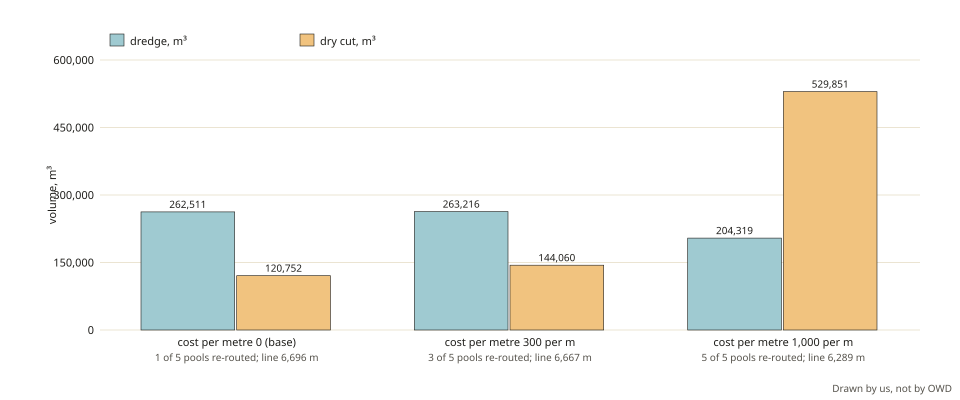

*Figure 10. The cost per metre trades cut for length. Drawn by us from the run files.*

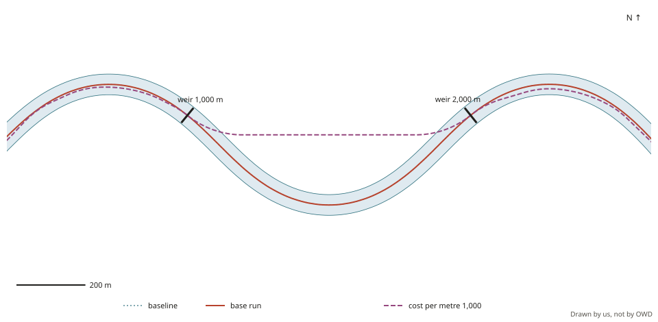

*Figure 11. At 1,000 per metre the pool from 1,000 m to 2,000 m leaves the river: its line is
848<!--=length-1000.pool2.line_length_m--> m long. Drawn by us from the run files.*

The weirs do not move in either run: the weir search does not read the cost per metre.

### The land cost

A land cost of 3.25 m³ per m² is the depth $D$: a m² of land costs as much as cutting it to the full
depth. The channel is 49.9<!--=land.land.footprint_width_m--> m wide at the water surface.

In the pool with the loop the baseline takes 31,375<!--=land.pool4.baseline_land_area_m2--> m² of
land and the searched line takes 19,855<!--=land.pool4.land_area_m2--> m². The line moves towards the
river ([figure 12](#fig-12)). The volumes hardly change (dry cut
+0.8<!--=land.volumes.dry_change_pct--> %): the land cost steers the line and is never added to a
volume. The same pool is re-routed, and the other four still keep the baseline.

<a id="fig-12"></a>

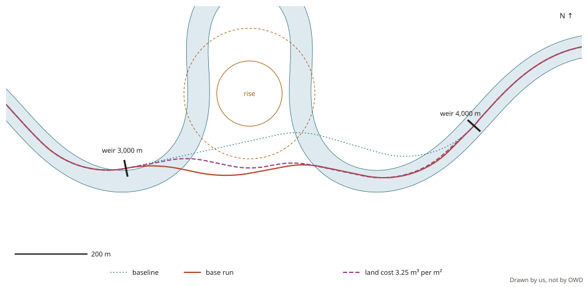

*Figure 12. The pool with the loop, with and without the land cost. Drawn by us from the run files.*

### The flood cost

At 3,000 per hectare nothing moves. Lowering the pool at 6.0 m by half a metre would add
21,912<!--=flood-20000.cut_added_m3--> m³ of cut (below). It would save
5.94<!--=flood-20000.flooded_saved_ha--> ha of flooded land, worth
17,813<!--=flood-3000.saving_if_lowered--> at 3,000 per hectare: less than the cut. The total cost rises by the flood cost only
(21,750<!--=flood-3000.flood.flood_cost-->).

At 20,000 per hectare the third weir lifts 1.5<!--=flood-20000.weir3.lift_m--> m in place of 2 m,
and the fourth 1.0<!--=flood-20000.weir4.lift_m--> m in place of 0.5 m. The pool from 3,000 m to
4,000 m drops to 5.5<!--=flood-20000.flood.pool4.level_m--> m and floods
0.56<!--=flood-20000.flood.pool4.flooded_ha--> ha in place of 6.5 ha. The weir search's cut rises
from 309,031<!--=base.flood.cut_cost--> to 330,944<!--=flood-20000.flood.cut_cost--> m³: that
difference is what the lower pool costs in cut. At 20,000 per hectare the 5.94 ha are worth
118,750<!--=flood-20000.saving_if_lowered-->, more than the cut, so the pool is lowered. The structure cost is the same in both cascades (four
weirs with lifts that add to 6.5 m), so here the trade is between cut and flooded land alone. In the volumes stage the dry cut rises
by 12<!--=flood-20000.volumes.dry_change_pct--> %.

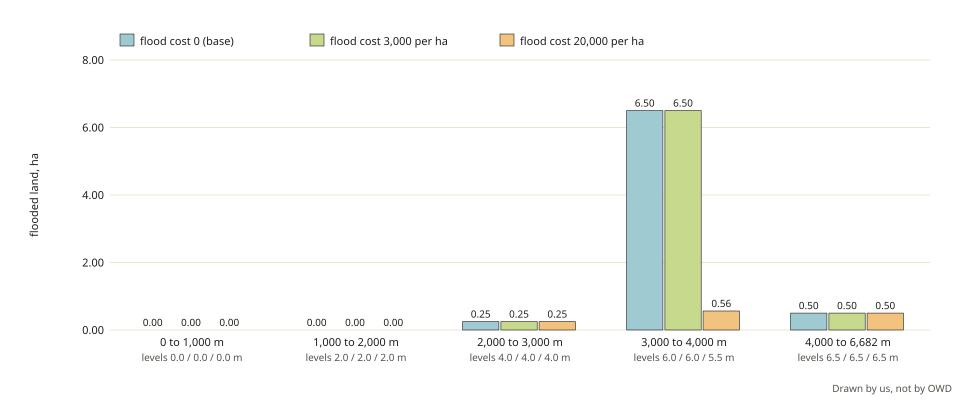

*Figure 13. Flooded land per pool at three flood costs. Drawn by us from the run files.*

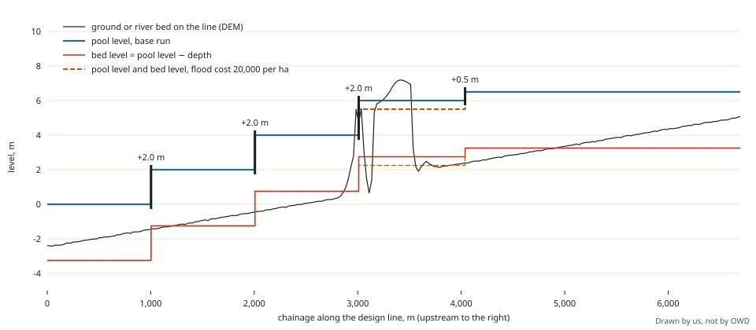

*Figure 14. The pool levels with a flood cost of 20,000 per hectare, against the base run. Drawn by
us from the run files.*

### A bank limit

With a limit of 0 m above bank-full, the pool at 6.0 m (0.39 m above bank-full) is not allowed. The
search gives the same cascade as the flood cost of 20,000 did. That pool, now at 5.5 m, stands
−0.11<!--=bank-0.flood.pool4.max_above_bank_m--> m against bank-full: 0.11 m below it. No pool is
nearer to bank-full.

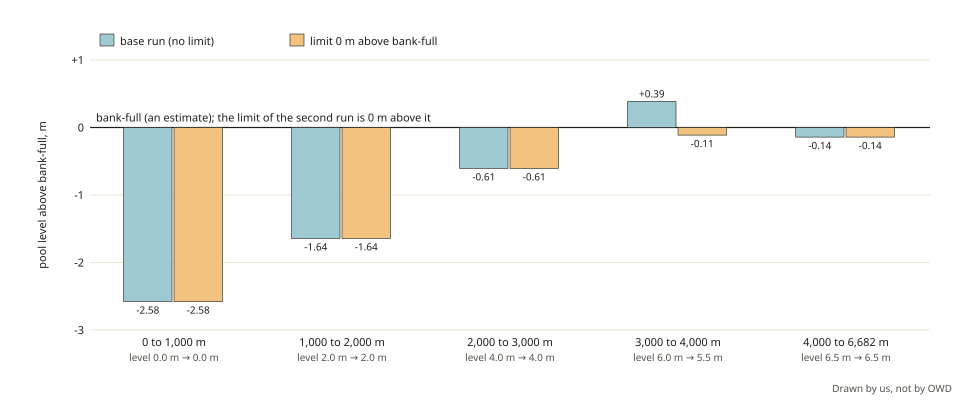

*Figure 15. Height above bank-full per pool. Drawn by us from the run files.*

### Free seams

With `--free-seams` and the default straight of 170 m through each weir, nothing moves. All four weir
sites stay pinned, and the tool says why for each. Its warnings, untouched:

<!-- file: example/runs/free-seams.txt -->
```text
owd: warning: Pool lattice: the weir site at 1000 m is pinned to the baseline's point and heading: with a free end here, the pool or piece upstream would keep its baseline (the line there is straight for 10 m against 170 m asked; the baseline's local radius there is 630 m)
```

The rule behind it: a weir site is freed only when the pools on both sides of it then use their
searched lines. Here the pool that ends at each weir site (the one at lower chainage) still costs
more than its baseline, so it would keep the baseline, and a free end would meet nothing.

Read the tool's words with care here. In these warnings it calls the pool at lower chainage
"upstream" and the one at higher chainage "downstream". In this example chainage runs upstream, so
the tool's "upstream" pool is the one downstream of the weir. Take the two words in these warnings
as "before" and "after" along the chainage.

With `--weir-straight 0` a weir site is a plain gate. The weir site at 3,000 m goes free. The pool
that ends on it (2,000 m to 3,000 m) now costs 1,022<!--=free-seams-0.pool3.cost--> in place of
13,223<!--=base.pool3.cost-->, beats its baseline and is used. The dry cut changes by
−7.9<!--=free-seams-0.volumes.dry_change_pct--> %, to
111,227<!--=free-seams-0.volumes.excav_m3--> m³, and the whole cut by
6,019<!--=free-seams-0.volumes.total_saved_m3--> m³. The other three weir sites stay pinned, with their
reasons.

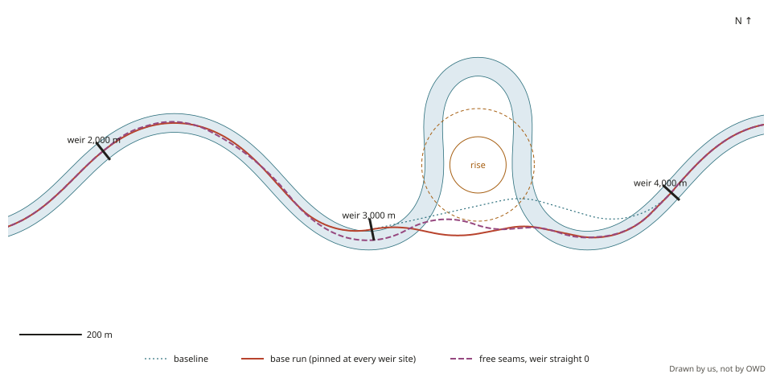

*Figure 16. The line through the freed weir site at 3,000 m. Drawn by us from the run files.*

A weir with no straight through it is not a design for a lock. This run shows what the pinned point
costs, not a line to build.

## 10 How this document stays true

The document is checked by tests, so that a change to the method that leaves it behind fails. This
section is for those who keep the document; an engineer who only reads it can skip to
[Report a finding](#report-a-finding).

| What | How it is held | When it runs |
|---|---|---|
| The settings tables of appendix B | A test compares every name and default with the engine's typed settings. A new setting fails to compile in the test; a changed default fails it. | Every change |
| Every number of the example | Each number in this document carries a hidden key. A test compares it with the stored numbers of the example, at the precision shown. | Every change |
| The stored numbers | Tests run each of the nine runs again and compare with the stored numbers to 1 part in a million. | Nightly (they take minutes) |
| The tool's printed output | Each block of printed output must be found, word for word, in the stored output of its run. | Every change |
| Each guarantee and each item of section 7 | Each carries a hidden anchor that names the test that pins it. A check fails when a named test no longer exists. | Every change |
| The station by hand | The example script works the section from the formulas of section 3 and stops if it differs from the tool. | When the example is run |

**What is asked and not enforced.** A test cannot read prose. The description of an algorithm, a
figure, and the planned method of section 8 are kept true by the rule in the contributor guide: a
change to the optimise or alignment code, its settings or its checks updates this document in the
same change. A reviewer holds that rule.

**The example is regenerated by one script** ([appendix A](appendices.md#a-commands-for-every-number)).
It runs the tool, stores the numbers, and draws the figures.

### Report a finding

If a statement here is wrong, or a number does not come out, tell us. Open an issue on the project's
issue tracker, [github.com/African-River-Corridors/open-waterway-designer/issues](https://github.com/African-River-Corridors/open-waterway-designer/issues).
One finding to one report. Include:

- the section and the sentence or number;
- what you expected, and why (a formula, a standard, a hand calculation);
- what you got: the commands you ran and what the tool printed;
- the version (`owd --version`) and, if you can, the design file. Use synthetic data, or data you may
  publish: the tracker is public.

A security problem goes through the private route in the project's security policy, not the tracker.

### Glossary

| Term | Meaning |
|---|---|
| **Baseline** | The line the optimise stage starts from: the alignment stage's line, or the river centreline when there is none. Chainages of weirs and pools are along it. |
| **Bank-full** | An estimate of the level of the lower bank, from the DEM (section 4). |
| **Bed level** | The level of the channel bottom: pool level less the depth. |
| **Benched** | Of one side of a section: cut with a berm and an upper slope above the pool level (section 3). |
| **Cascade** | A set of weirs with their lifts, and so the pool levels, along the line. |
| **Chainage** | Distance along a line from its downstream end, in metres. |
| **Channel prism** | The channel below the pool level: the bed and the two under-water slopes. |
| **Closing path** | The arc, straight and arc that end a pool's line exactly on its end point and heading. |
| **Corridor** | The ground within `corridor_half_m` of the baseline; where a pool is searched. |
| **Cut Model A** | The section of section 3. The default of the volumes stage. |
| **Design line** | The line of the channel: one line per design. After the optimise stage it is the pool search's line. |
| **Dredge / dry cut** | Cut inside / outside the river polygon. |
| **Gate** | With free seams: the stretch of a cross-line the line may pass at a seam or weir site. |
| **Lattice** | The set of moves and states of the pool search. The tool calls the search's line "Pool lattice". |
| **Lift** | The step in water level at a weir. |
| **No-go area** | Ground the engineer has marked as closed to the channel. The pool search reports it and does not steer by it. |
| **Pinned** | Held to the baseline's point and heading. |
| **Pool** | A stretch of the line at one water level, between two weirs (or a weir and an end). |
| **Rake** | One row of samples across the line in the search cost. |
| **River polygon** | The outline of the river's water. Inside is "wet"; outside is "dry" or "land". |
| **$R_{\min}$** | The minimum radius of the design line, from the rule set. |
| **Rule set** | A design standard written as rules that OWD applies: it gives the width, the depth, the minimum radius and the bend widening for a vessel. |
| **Seam** | A boundary between two pieces of one long pool. |
| **Search cost** | The cost the pool search reads (section 5). Not a volume. |
| **Stale** | Of a stage: an input or an earlier result changed after it ran. |
| **Station** | A point of the line where the volumes stage takes a section, every 25 m. |
| **Tallest face** | The greatest height of ground above the pool level at a point that is cut. |
| **Weight** | A factor of the cost, set by the engineer. Not a price unless you make it one. |
